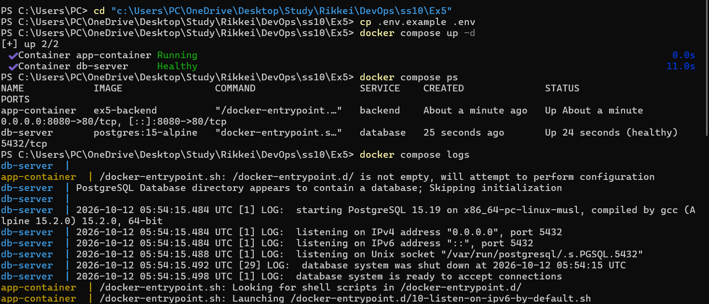
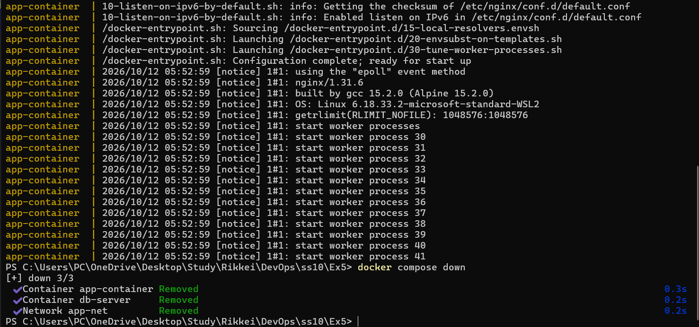

# Bài 5: Tự động hóa điều phối đa dịch vụ với Docker Compose & File .env

## Mục tiêu

Đóng gói bài Ex4 thành tệp khai báo `docker-compose.yml` theo chuẩn **Infrastructure as Code (IaC)**.  
Quản lý hạ tầng đa container bằng Docker Compose CLI v2 và bảo mật biến môi trường bằng `.env`.

---

## Cấu trúc thư mục

```
ex5/
├── docker-compose.yml   ← Khai báo 2 services: backend + database
├── .env.example         ← Mẫu biến môi trường (commit lên Git)
├── .gitignore           ← Loại trừ .env thực tế khỏi Git
└── README.md
```

> **Lưu ý:** File `.env` chứa mật khẩu thực tế KHÔNG được commit — đã khai báo trong `.gitignore`.

---

## Cách chạy

### Bước 1 — Chuẩn bị file `.env`

```bash
cp .env.example .env
```

Nội dung `.env` (chỉnh sửa nếu cần):

```env
DB_NAME=appdb
DB_USER=appuser
DB_PASSWORD=secret123
PORT=8080
```

### Bước 2 — Khởi chạy toàn bộ stack

```bash
docker compose up -d
```

Kết quả mong đợi:

```
[+] Running 3/3
 ✔ Network app-net    Created
 ✔ Volume  db-data    Created
 ✔ Container db-server    Started
 ✔ Container app-container  Started
```

Docker Compose tự động:
- Tạo network `app-net` (bridge)
- Tạo volume `db-data`
- Khởi chạy `database` (postgres:15-alpine) và chờ healthcheck xanh
- Khởi chạy `backend` (nginx:alpine) sau khi DB sẵn sàng

### Bước 3 — Kiểm tra trạng thái

```bash
docker compose ps
```

Kết quả mong đợi:

```
NAME            IMAGE                COMMAND                  SERVICE    STATUS
app-container   nginx:alpine         "/docker-entrypoint.…"   backend    running
db-server       postgres:15-alpine   "docker-entrypoint.s…"   database   running (healthy)
```

### Bước 4 — Xem logs

```bash
# Xem logs realtime toàn bộ stack
docker compose logs -f

# Xem logs riêng từng service
docker compose logs database
docker compose logs backend
```

### Bước 5 — Dừng và dọn dẹp

```bash
# Dừng và xóa containers + network (giữ lại volume)
docker compose down

# Dừng và xóa tất cả kể cả volume (XÓA DỮ LIỆU)
docker compose down -v
```

---

## Nội dung `docker-compose.yml`

```yaml
services:
  database:
    image: postgres:15-alpine
    container_name: db-server
    restart: unless-stopped
    environment:
      POSTGRES_DB: ${DB_NAME}
      POSTGRES_USER: ${DB_USER}
      POSTGRES_PASSWORD: ${DB_PASSWORD}
    volumes:
      - pgdata:/var/lib/postgresql/data
    networks:
      - backend-net
    healthcheck:
      test: ["CMD-SHELL", "pg_isready -U ${DB_USER} -d ${DB_NAME}"]
      interval: 10s
      timeout: 5s
      retries: 5

  backend:
    image: nginx:alpine
    container_name: app-container
    restart: unless-stopped
    ports:
      - "${PORT}:80"
    environment:
      DB_HOST: database
      DB_PORT: 5432
      DB_NAME: ${DB_NAME}
      DB_USER: ${DB_USER}
      DB_PASSWORD: ${DB_PASSWORD}
    depends_on:
      database:
        condition: service_healthy
    networks:
      - backend-net

volumes:
  pgdata:
    name: db-data

networks:
  backend-net:
    driver: bridge
    name: app-net
```

---

## Giải thích các thành phần chính

| Thành phần | Ý nghĩa |
|---|---|
| `${DB_NAME}` | Biến được nạp tự động từ file `.env` |
| `depends_on: condition: service_healthy` | Backend chỉ khởi động sau khi DB healthcheck xanh |
| `healthcheck: pg_isready` | Xác nhận PostgreSQL thực sự sẵn sàng nhận kết nối |
| `DB_HOST: database` | Tên service = hostname DNS nội bộ, Docker tự phân giải IP |
| `volumes: pgdata: name: db-data` | Named volume khai báo ở root level, dữ liệu bền vững |
| `networks: backend-net: name: app-net` | Custom bridge network khai báo ở root level |

---

## Nội dung `.env.example`

```env
# PostgreSQL Database
DB_NAME=appdb
DB_USER=appuser
DB_PASSWORD=secret123

# Port mapping ra ngoài host
PORT=8080
```

---


